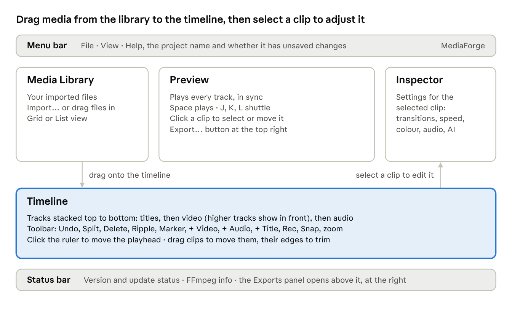

# MediaForge User Manual

MediaForge 1.3.1 · November 2026

MediaForge is a video and audio editor for Windows. You import clips, arrange them on a
timeline, improve the picture and sound, and export a finished file, all on your own computer.

**Contents**

1. [Installing and updating](#installing-and-updating)
2. [The window at a glance](#the-window-at-a-glance)
3. [Your first video in five minutes](#your-first-video-in-five-minutes)
4. [Importing media](#importing-media)
5. [Editing on the timeline](#editing-on-the-timeline)
6. [Playing and previewing](#playing-and-previewing)
7. [Titles, transitions, effects and animation](#titles-transitions-effects-and-animation)
8. [Working with sound](#working-with-sound)
9. [AI tools](#ai-tools)
10. [Exporting](#exporting)
11. [Projects](#projects)
12. [Arranging the workspace](#arranging-the-workspace)
13. [Keyboard shortcuts](#keyboard-shortcuts)
14. [Troubleshooting](#troubleshooting)
15. [Help and licenses](#help-and-licenses)

## Installing and updating

MediaForge runs on Windows 10 and 11 (64-bit). You don't need administrator rights to install it.

1. Download **MediaForge-Setup-1.3.1.exe** from
   [the releases page](https://github.com/kayceechris/mediaforge/releases/latest).
2. Run it. Windows may show **"Windows protected your PC"**, because the installer isn't
   code-signed yet. Click **More info**, then **Run anyway**.
3. Choose an install folder and finish. Shortcuts appear on the desktop and in the Start menu.

**Updates are automatic.** MediaForge checks for a new version at startup and every 6 hours. It
downloads updates in the background and shows **Restart to update** in the status bar at the
bottom. To check yourself, use **Help → Check for updates**; the status bar then says "Up to
date" or explains what went wrong. Your version number is shown at the bottom left.

**Opening projects from Explorer:** double-click a `.mfproj` project file to open it in
MediaForge.

**Uninstalling:** Windows Settings → Apps → MediaForge → Uninstall. Uninstalling keeps your
projects, settings and recent-projects list.

## The window at a glance

You import files into the **Media Library** and build the video on the **Timeline**. You watch
it in the **Preview** and fine-tune whichever clip is selected in the **Inspector**. Every panel
can be resized (see [Arranging the workspace](#arranging-the-workspace)).

## Your first video in five minutes

This walkthrough makes a short video with a title, a transition and music, then saves and
exports it.

> **Prefer to be shown?** Click **🎓 Tutorials** at the top right of the window (or **Help →
> Tutorials…**). Each lesson highlights what to press next and moves on by itself when you've
> done it: _Your first video_, _Titles and animation_, _Sound and music_, _Vertical video for
> Shorts and Reels_ and _Green screen_. No footage at hand? Every lesson offers a sample clip to
> practise on. Finished lessons get a tick.

1. **Import.** Click **Import…** in the Media Library (or press Ctrl+I). Pick a few video clips,
   a still image or two, and a music file. You can also drag files from Explorer straight into
   the library.
2. **Place clips.** Drag the first video from the library onto the **V1** track. Drag the next
   one so it starts where the first ends; clips snap to each other.
3. **Add music.** Drag the music file onto the **A1** track.
4. **Trim.** Drag the left or right edge of a clip to shorten it. To cut a clip in two, put the
   playhead where you want the cut (click the ruler above the tracks) and press **S**.
5. **Add a transition.** Click the second clip, and in the Inspector choose
   **Transition in → Crossfade**.
6. **Add a title.** Move the playhead to the start (press Home), click **+ Title** in the
   timeline toolbar, then type your text in the Inspector.
7. **Watch it.** Press **Space** to play and again to pause.
8. **Save.** Press **Ctrl+S** and choose a name. MediaForge also autosaves a recovery copy every
   minute.
9. **Export.** Press **Ctrl+E**, choose **MP4 1080p**, click **Export…** and pick where to save.
   A progress bar appears at the bottom right; click **Show in folder** when it says Done.

## Importing media

Imported files stay where they are on your disk; MediaForge only remembers their location. Don't
delete or move them while you edit. If you do, see _Missing media_ under
[Projects](#projects).

**Ways to import:** the **Import…** button, **Ctrl+I**, **File → Import media…**, or dragging
files from Explorer into the Media Library.

| Kind  | File types                                                       |
| ----- | ---------------------------------------------------------------- |
| Video | MP4, M4V, MOV, MKV, WebM, AVI, WMV, MPG/MPEG, TS, MTS, M2TS, GIF |
| Audio | MP3, WAV, AAC, M4A, FLAC, OGG/OGA, Opus, WMA, AIF/AIFF           |
| Image | PNG, JPG/JPEG, WebP, BMP, TIF/TIFF                               |

**The Media Library** shows each file with a thumbnail, its kind (VIDEO, AUDIO or IMAGE), its
resolution and its length. Switch between **Grid** and **List** at the top of the panel; List
view also shows the frame rate and whether a video has sound. Audio files show their waveform.

**Preview copies.** Some files are hard to play smoothly while editing: old AVI files, ProRes,
10-bit or very large video. MediaForge makes a lightweight 540p copy of these in the
background, marked with a **proxy** badge. The copy is only used for watching while you edit;
exports always use your original file at full quality. Until the copy is ready, the preview
shows "Preparing preview proxy…".

## Editing on the timeline

The timeline is where you build your video. Time runs left to right, and tracks are stacked top
to bottom. Higher video tracks appear in front of lower ones.

**Tracks.** Video tracks (V1, V2…) hold video clips and still images, audio tracks (A1, A2…)
hold sound, and text tracks (T1…) hold titles. Add tracks with **+ Video**, **+ Audio** or
**+ Title** in the toolbar, or drop a clip on **Drop here to add a new track** under the last
track. Each track header has:

- **M** to mute (on a video track this hides it), **S** to solo (hear only soloed tracks),
  **L** to lock it against changes
- a volume slider for the whole track
- ▲ ▼ to move the track up or down, and × to delete it

**Placing and moving.** Drag a file from the library onto a track, or drag a clip to a new
position or another track. A clip you drop **replaces** whatever it lands on; clips never overlap
on a track.

**Selecting.** Click a clip to select it and show its settings in the Inspector. Ctrl+click or
Shift+click adds clips to the selection or removes them; **Esc** clears it.

**Trimming.** Drag a clip's left or right edge. A trim stops at the neighbouring clip and at the
start or end of the source file.

**Splitting.** Put the playhead where you want the cut and click **Split** or press **S**. If
clips are selected, only those are split; otherwise every clip under the playhead is.

**Deleting.** **Delete** (or Backspace) removes the selection and leaves a gap. **Ripple**
(Shift+Delete) removes it and slides everything after it to the left to close the gap.

**The playhead.** Click or drag on the time ruler to move it. ← / → step one frame,
Shift+← / Shift+→ step one second, and Home and End jump to the start or end.

**Snapping.** With **Snap** on, clips, clip edges and the playhead line up with clip edges,
markers and the playhead. Hold **Alt** while dragging to place something freely.

**Markers.** Press **M** (or click **Marker**) to drop a marker at the playhead. Use markers to
note a beat or a point to come back to. Click a marker to jump to it, double-click it to give it
a name, and right-click it to remove it.

**Chapters.** Named markers become chapters: put one where each part of the video starts. MP4 and
WebM exports include them (players show them as chapters), and **File → Copy YouTube chapters**
puts lines like `0:00 Intro` on the clipboard, ready to paste into a YouTube description. The
first chapter always starts at 0:00, called "Intro" if there's no marker there. MediaForge warns
you if YouTube would ignore them (it needs at least three chapters, each 10 seconds or longer).

**Zoom.** Use the zoom slider, the **−** and **+** buttons or keys, or Ctrl+scroll over the
timeline to zoom around the pointer.

**Undo.** Ctrl+Z undoes and Ctrl+Shift+Z (or Ctrl+Y) redoes. Hover over the Undo and Redo
buttons to see what they will undo or redo. A whole drag, or a whole slider movement, counts as
one step.

## Playing and previewing

The Preview panel shows the frame at the playhead with every track, title, effect and transition
applied. It plays picture and sound in sync.

**Controls** under the picture, from left to right: go to start (Home), previous frame (←),
play/pause (Space), next frame (→), go to end (End). Next to them is the current time, shown as
hours:minutes:seconds:frames.

**Shuttle with J, K and L.** **L** plays forward; press it again for 2×, 4× and up to 8×. **J**
does the same backwards, and **K** stops. The speed shows next to the controls while you
shuttle.

**Master volume and level meters.** The **Master volume** slider sets the overall loudness of
the preview and of exports. The meters beside it show the output level. If they often hit the
top, the sound may distort when exported.

**Working in the picture.** While paused, click something in the preview to select its clip; a
dashed outline shows which one. Drag it to move it around the frame, which is handy for
picture-in-picture and titles.

## Titles, transitions, effects and animation

You set all of these in the **Inspector** after selecting a clip, and every change can be undone.
What you see and hear in the preview is exactly what the export produces.

**Titles.** Click **+ Title** to add a 5-second title at the playhead on a text track. In the
Inspector, type the text (press Enter for more lines) and choose the font, colour, size,
**Bold**, **Shadow** and position. To make a title longer or shorter, drag its edges or type a
**Duration**. Still images work the same way (5 seconds by default).

- **Style…** applies a ready-made layout: **Title**, **Big headline**, **Lower third** (name and
  role in the bottom-left corner), **Caption** or **Corner tag**. Your text is kept.
- **Alignment** sets left, centre or right alignment for lines of different lengths.
- **Box** puts a background box behind the text. Set its colour, **Box opacity** and
  **Box padding**.
- **Animate in** and **Animate out** move the title on and off screen: **Fade**, **Slide up**,
  **Slide down**, **Slide in from right**, **Slide in from left**, **Rise**, **Pop**, **Zoom out**
  or **Typewriter** (letters appear one at a time). Set each one's length in seconds.

**Transitions.** Select the clip that comes _second_ and pick **Transition in**:

| Transition                                    | What you see                                                           |
| --------------------------------------------- | ---------------------------------------------------------------------- |
| **Crossfade**                                 | The next clip gradually appears over the previous one                  |
| **Dip to black** / **Dip to white**           | The picture fades to black (or flashes white), then into the next clip |
| **Wipe right / left / up / down**             | A hard edge moves across and reveals the next clip                     |
| **Push left / right / up / down**             | The next clip slides in and pushes the previous one out                |
| **Slide in from right / left / bottom / top** | The next clip slides in over the previous one                          |
| **Zoom**                                      | The previous clip zooms in as the next one zooms out into place        |
| **Circle reveal**                             | A growing circle from the centre reveals the next clip                 |

Set its **Length** in seconds. A transition sits centred on the cut. It uses a little footage
beyond the clips' trim points; if there is none, the first or last frame is held. Sound blends
across the cut too (dips dip the sound). On a clip with nothing directly before it, the
transition comes in from black. A white gradient on a clip shows that it has a transition.

**Fades.** Drag the small round handle at a clip's top-left corner (fade in) or top-right corner
(fade out), or type seconds into **Fade in** and **Fade out**. Fades affect both picture and
sound, so a fade-out at the end fades to black and silence.

**Speed.** Choose 0.25×, 0.5×, 1×, 1.5×, 2× or 4×, or type a **Custom** value. The clip gets
shorter or longer, and the clips after it on the same track move to make room. Voices keep their
normal pitch. For a moment after a change the sound may play "chipmunk-style" while the
corrected audio is prepared.

**Speed ramps.** For a video clip, **Ramp** in the **Speed** section changes the speed smoothly
across the clip: **Slow motion in the middle**, **Speed up**, **Slow down**, **Fast – slow –
fast** or **Hero (slow at the end)**. MediaForge renders the ramped clip (a few seconds),
keeping the sound's pitch, and the clips after it move to make room. Choosing another ramp
starts again from the original footage; **No ramp** puts the clip back as it was.

**Transform and picture-in-picture.** In **Transform & animation**, **Position X/Y**, **Scale**,
**Rotation**, **Opacity** and **Crop** (left, right, top, bottom) place a clip in the frame.
**PiP** shrinks it to a third of its size and puts it in the bottom-right corner; **Reset** undoes
all of these. You can also drag the clip in the preview.

**Keyframe animation.** To make a clip move, grow, turn or fade over time:

1. Put the playhead where the movement should start and click the diamond (◇) beside
   **Position X**, **Position Y**, **Scale**, **Rotation** or **Opacity**. It fills in (◆): a
   keyframe now holds that value at that moment.
2. Move the playhead later and change the slider (or drag the clip in the preview). A new
   keyframe is added automatically.
3. Play it back: the clip moves smoothly between the keyframes.

Keyframes show as small diamonds on the clip in the timeline; click one to jump to it, or use
the **Previous keyframe** and **Next keyframe** buttons. Click a filled diamond to remove that
keyframe, and **Clear animation** removes them all. **Animate…** applies a ready-made movement
over the whole clip: **Ken Burns** (slow zoom and pan, good for photos), **Zoom in**,
**Zoom out**, **Pan left**, **Pan right** or **Pop in**.

**Colour.** Use the **Brightness**, **Contrast** and **Saturation** sliders; saturation 0 makes
the picture black and white. Double-click a slider to reset it.

**Video effects.** The **Effects** section has **Apply a look…** for one-click styles
(**Black & white**, **Vintage**, **Noir**, **Warm**, **Cool**, **Vivid**, **Dreamy**) and
sliders you can fine-tune:

| Effect            | What it does                                       |
| ----------------- | -------------------------------------------------- |
| **Blur**          | Softens the picture                                |
| **Sharpen**       | Makes edges crisper                                |
| **Vignette**      | Darkens the corners                                |
| **Black & white** | Removes colour, partly or fully                    |
| **Sepia**         | Gives an old-photo brown tint                      |
| **Hue**           | Shifts all colours around the colour wheel         |
| **Warmth**        | Makes the picture warmer (orange) or cooler (blue) |

**Flip horizontal** mirrors the picture and **Flip vertical** turns it upside down. **Reset**
removes all effects.

**Green screen.** To put a person filmed in front of a green (or blue) screen over another
picture, place the background on a track below, select the green-screen clip and tick
**Remove background colour** in the **Green screen** section. **Auto** picks the screen colour
from the edges of the frame at the playhead; you can also choose **Green**, **Blue** or any
colour. Then adjust:

- **Similarity:** how close to the screen colour a pixel must be to disappear. Raise it if bits
  of the screen remain; lower it if the subject starts to vanish.
- **Smoothness:** softens the edge between the subject and the background.
- **Spill removal:** removes the green (or blue) tint the screen reflects onto hair and edges.

**Colour LUTs.** A LUT (a `.cube` file) is a ready-made colour grade, such as a film look from a
colourist. In **Effects**, click **Import LUT…** and choose the file; it's applied to the clip
and kept in the project, so every clip can use it from the **Colour LUT** list. **LUT
strength** blends it with the original colours.

**Stabilize.** For shaky handheld video, choose **Light**, **Medium** or **Strong** in
**Effects** and click **Stabilize**. MediaForge makes a steadied copy of the clip (it zooms in
slightly to hide the moving edges) and switches the clip to it. Undo switches back.

**Masks and blend modes.** In **Mask & blend**, a **Mask** (**Ellipse** or **Rectangle**) shows
only part of the clip: set its position, size and **Feather** (a soft edge), or tick **Invert** to
hide the inside instead. Use it for a spotlight effect, or to show two takes side by side. **Blend**
changes how the clip mixes with what's below: **Multiply** darkens (good for shadows and
textures), **Screen** lightens (light leaks, flares, smoke), plus **Overlay**, **Darken**,
**Lighten** and **Difference**.

**Split screen.** Select two to four clips that play at the same time on different tracks
(Ctrl+click to add to the selection). The Inspector shows **Split screen** layouts: **Side by
side**, **Top and bottom**, **One big, two small**, **Three columns** and **2 × 2 grid**, with an
optional gap. The clip on the top track fills the first cell, and each clip is cropped to fit its
cell.

**Adjustment layers.** **+ Adjust** in the timeline toolbar adds a 5-second adjustment layer on a
track above everything. Its colour, effects, LUT and mask change everything below it while it
lasts. Use one to grade a whole scene at once, or to fade everything to black and white for a
flashback. Drag its edges to change how long it lasts; fades work on it too.

**Audio visualizer.** **+ Visualizer** in the timeline toolbar adds animated **Spectrum bars**
or a **Waveform** driven by the sound of an audio track (choose the track, style, colour and
number of bars in the **Visualizer** section). Move and size it like a picture, so it can sit
under a podcast cover or over a music video.

## Working with sound

Clips with sound show their waveform on the timeline. Sound can come from video clips as well as
audio clips.

**Volume at three levels**, all shown in decibels (dB):

- **Clip gain** in the Inspector's **Audio** section: one clip, up to +12 dB.
- The **track volume** slider in the track header: everything on that track, up to +6 dB.
- **Master volume** in the Preview panel: the whole mix.

Volume changes take effect immediately, even during playback. **Fades** work as described above
and also fade the sound.

**Audio tools** (in the Inspector, for a clip with sound). Each one makes a cleaned-up copy and
switches the clip to it. The original stays in the library, and Undo switches back.

| Tool                                       | What it does                                                                                    | Use it when                                       |
| ------------------------------------------ | ----------------------------------------------------------------------------------------------- | ------------------------------------------------- |
| **Normalize (−16 LUFS)**                   | Raises or lowers the clip to podcast and streaming loudness, with a limiter so peaks don't clip | A recording is too quiet or too loud              |
| **Reduce noise** (Light / Medium / Strong) | Removes steady background noise                                                                 | Hiss, hum, fan or air-conditioning noise          |
| **Isolate voice**                          | Keeps the voice and removes almost everything else, using a speech-trained neural network       | Speech recorded over traffic, music or room noise |
| **Detect silence** → **Cut silences**      | Finds quiet gaps, then cuts them out (keeping a short breath) and closes the gaps               | Tightening up talking-head or podcast recordings  |

**Audio effects** (in the Inspector, for a clip with sound) change how a clip sounds without
making a copy. **Apply a preset…** gives you a starting point:

| Preset            | Sounds like                                      |
| ----------------- | ------------------------------------------------ |
| **Telephone**     | A voice on a phone line: thin, no bass or treble |
| **Radio**         | A broadcast voice: focused and compressed        |
| **Voice clarity** | Speech that is clearer and more present          |
| **Big room**      | The sound of a large hall (reverb)               |
| **Echo**          | Repeats that fade away                           |
| **Deep voice**    | A lower-pitched voice                            |
| **Chipmunk**      | A higher-pitched voice                           |

Then adjust the sliders: **Low cut** and **High cut** remove frequencies below or above a point;
**Bass**, **Mid** and **Treble** boost or reduce those ranges; **Compressor** evens out loud and
quiet moments; **Echo** (with **Echo delay**) and **Reverb** add space; **Pitch** raises or
lowers the sound in semitones without changing its speed. Echo and reverb keep ringing for a
moment after the clip ends. **Reset** removes all audio effects.

Echo and reverb change immediately, even during playback. The other effects take a moment to
prepare after a change; until then the clip plays without them.

**Ducking (music under speech).** Select a clip on your music track and, in the **Audio**
section, set **Duck under** to the track with the voice (for example **Speech on A1**). The whole
music track then dips by the **Duck amount** (12 dB at first) whenever someone speaks, and comes
back up in the pauses. MediaForge finds the speech by itself ("Finding speech…" shows briefly).

**Recording a voice-over.** Move the playhead to where the narration should start and click
**● Rec** in the timeline toolbar. Allow microphone access if asked. The timeline plays while you
record, so you can talk over the picture, and a level meter shows your input. Click stop when
you're done. The take is saved and placed at that point on a free audio track.

## AI tools

The **AI tools** section of the Inspector appears for clips with sound or video. Speech
recognition runs on your computer using the Whisper model, and nothing is uploaded. The first
time, MediaForge downloads the speech model (about 76 MB), so you need internet once; after that
it works offline. A progress bar shows what's happening, and you can cancel long jobs.

**Generate subtitles.** Select a clip with speech, set **Spoken language** (or leave
**Detect automatically**), and click **Generate subtitles**. A 10-second clip takes about 5
seconds. The subtitles appear on a **Subtitles** track as ordinary titles. Click one to fix a
word or change its style, or drag its edges to change its timing. Subtitles appear in exported
videos. Running it again on the same clip replaces that clip's subtitles, and Undo removes them
in one step.

**Save subtitles as a file.** **File → Export subtitles (.srt)…** saves all subtitles as an SRT
file. YouTube, Vimeo and most video players can load it as separate captions that viewers can
switch on and off.

**Remove filler words.** Cuts "um", "uh" and similar hesitations out of the clip and closes the
gaps. Whisper often leaves these sounds out of its transcript, so expect it to catch some, not
all.

**Edit by transcript.** Select a clip with speech and click **Edit by transcript**. Its words
appear as text: click a word to jump to it, Shift+click another to select everything in between,
and press **Delete** to cut those words out of the video. The gap closes by itself, removed words
stay visible but struck through, and **Ctrl+Z** brings them back. It's the quickest way to remove
a fluffed sentence or a tangent.

**Auto reframe.** For video clips: makes the clip fill the project's frame and follows the
person in it, panning smoothly so they stay in view. Use it after switching a landscape video to
a vertical or square format (see _Projects_). If nobody is found, it follows whatever moves. The
first time, MediaForge downloads a small detection model (about 7 MB).

**Split at scene changes.** For video clips: splits the clip wherever the picture cuts to a new
shot, so you can rearrange or delete shots. Choose **Hard cuts only**, **Normal** or
**Sensitive** (which also finds softer changes). One Undo puts the clip back together.

## Exporting

Exporting turns your timeline into a single file that looks and sounds like the preview. Open
the export dialog with **Export…** at the top of the Preview panel, **Ctrl+E**, or
**File → Export…**.

| Format         | What you get                           | Good for                                              |
| -------------- | -------------------------------------- | ----------------------------------------------------- |
| **MP4 1080p**  | Full HD H.264 video with AAC sound     | Almost everything: YouTube, social media, phones, TVs |
| **MP4 720p**   | A smaller H.264 file                   | Email, messaging, slow connections                    |
| **MP4 4K**     | 2160p H.264 video                      | Large screens; slow without hardware encoding         |
| **WebM 1080p** | VP9 video with Opus sound              | Websites                                              |
| **MP3**        | Sound only, 320 kbps                   | Podcasts, music                                       |
| **WAV**        | Sound only, uncompressed 16-bit 48 kHz | Further audio editing                                 |

The export has the project's shape: in a vertical project, **MP4 1080p** gives a 1080×1920
video. If your timeline has named markers, **Chapters from markers** adds them as chapters.

**Range.** Export the **Whole timeline**, just the span of the **Selected clips**, or a
**custom** start and end in seconds. The dialog shows the size, frame rate and length before you
start.

**Encoder (MP4 only).** **Software (x264)** works on every computer. If your computer has a
supported graphics chip, faster hardware options appear (NVIDIA NVENC, Intel Quick Sync, AMD
AMF). If a hardware export fails, MediaForge redoes it in software automatically and adds a note
to the job.

**The export queue.** After you click **Export…** and choose where to save, the job appears in
the **Exports** panel at the bottom right with a progress bar. You can keep editing and queue
more exports; they run one at a time. **Cancel** stops a job without leaving a half-written
file. **Show in folder** opens the finished file's location, and **Clear finished** tidies the
list. The file only appears in its folder once it's complete.

Exports always use your original media at full quality, never the preview copies.

## Projects

A project file (`.mfproj`) stores your timeline and settings and points to your media files. It
doesn't contain the media itself.

**Format (landscape, vertical, square).** The **Project format** menu at the top of the Preview
panel sets the shape of the whole video: **Landscape 16:9** (YouTube, TVs), **Vertical 9:16**
(Shorts, Reels, TikTok), **Square 1:1** or **Portrait 4:5** (social feeds). Clips and titles keep
their places relative to the frame; titles keep the same size relative to the frame's width.
Landscape footage in a vertical project shows with bars at first: **Auto reframe** (see _AI
tools_) or **Scale** makes it fill the frame.

**Saving and opening.** Use the **File** menu: **New project** (Ctrl+N), **Open project…**
(Ctrl+O), **Save** (Ctrl+S) and **Save as…** (Ctrl+Shift+S). The project name at the top shows
**• unsaved changes** when there's something to save; undoing back to the last save clears it.
**File → Recent projects** lists your last ten projects.

**Closing safely.** If you close MediaForge, or open or start another project, while there are
unsaved changes, it asks **Save**, **Don't Save** or **Cancel**.

**Autosave and crash recovery.** While there are unsaved changes, MediaForge saves a recovery
copy every minute. If the app or your computer crashes, the next start offers **Recover unsaved
changes?** with the time of the last autosave. Choose **Recover** to get your work back (then
save it), or **Discard**. Autosave never overwrites your project file; only Save does.

**Missing media.** If media files were moved, renamed or deleted since the project was saved, a
**Missing media** list appears when you open the project. Click **Locate…** next to a file and
point to its new location; any other missing files in the same folder are found automatically.
You can also click **Continue without them** and fix them later with the red
**Missing · relink** badge in the library. You can't export while media is missing.

**Moving a project to another computer.** Keep your media in the same folder as the project file
(or in a folder inside it) and copy the whole folder. MediaForge finds files relative to the
project.

**Where MediaForge keeps its own files.** Cleaned-up audio (from Normalize, Reduce noise and
Isolate voice) and voice-over recordings are stored in `%APPDATA%\MediaForge`, in folders called
`processed` and `recordings`. Your projects refer to these files, so don't delete that folder. If
you move a project to another computer, copy those files too and relink them.

## Arranging the workspace

Drag the thin gaps between panels to make the library, inspector or timeline bigger.
Double-click a gap to reset it, or use **View → Reset panel layout** to reset all of them.
MediaForge remembers your layout between sessions. With the keyboard, focus a gap with Tab and
use the arrow keys (hold Shift for bigger steps).

## Keyboard shortcuts

Press **?** or **F1** in the app to see this list at any time. Shortcuts with Ctrl also work
while you're typing in a text field. The others don't, so they never get in the way of typing.

| Shortcut                  | Action                                   |
| ------------------------- | ---------------------------------------- |
| Ctrl+N                    | New project                              |
| Ctrl+O                    | Open project                             |
| Ctrl+S                    | Save                                     |
| Ctrl+Shift+S              | Save as                                  |
| Ctrl+I                    | Import media                             |
| Ctrl+E                    | Export                                   |
| Ctrl+Z                    | Undo                                     |
| Ctrl+Shift+Z or Ctrl+Y    | Redo                                     |
| S                         | Split at playhead                        |
| Delete or Backspace       | Delete selected clips (leave a gap)      |
| Shift+Delete              | Ripple delete (close the gap)            |
| M                         | Add marker at playhead                   |
| Esc                       | Clear selection                          |
| Ctrl+click or Shift+click | Add or remove a clip from the selection  |
| Alt while dragging        | Move or trim without snapping            |
| Space                     | Play / pause                             |
| L                         | Play forward (press again to go faster)  |
| J                         | Play backward (press again to go faster) |
| K                         | Stop                                     |
| ← / →                     | Previous / next frame                    |
| Shift+← / Shift+→         | Back / forward one second                |
| Home / End                | Go to start / end                        |
| + / −                     | Zoom timeline in / out                   |
| Ctrl+scroll               | Zoom timeline at the pointer             |
| ? or F1                   | Show keyboard shortcuts                  |

## Troubleshooting

| Problem                                                       | What to do                                                                                                                                                        |
| ------------------------------------------------------------- | ----------------------------------------------------------------------------------------------------------------------------------------------------------------- |
| "Windows protected your PC" when installing                   | Click **More info**, then **Run anyway**. The installer is safe but not yet code-signed.                                                                          |
| The preview says "Preparing preview proxy…"                   | MediaForge is making a copy of that file that plays smoothly. Wait for the **proxy** badge in the library; you can keep editing meanwhile.                        |
| Sound plays fast and high-pitched right after a speed change  | The pitch-corrected sound is still being prepared and switches over within seconds. Exports always sound correct.                                                 |
| A file won't import ("Unsupported file type")                 | Check that it has one of the extensions listed under [Importing media](#importing-media). Damaged files may also be refused.                                      |
| "Missing media" when opening a project                        | The files were moved or renamed. Click **Locate…** and pick them in their new folder.                                                                             |
| Export fails with "Some media is offline"                     | Relink the missing files first (look for the red badge in the library), then export again.                                                                        |
| Export note: "…failed; exported with software encoding"       | The hardware encoder didn't work on this computer, so MediaForge used software instead. The file is fine; choose **Software (x264)** next time to skip the retry. |
| A 4K export is very slow                                      | Choose a hardware encoder in the export dialog if one is listed, or export at 1080p.                                                                              |
| Generate subtitles is stuck on "Downloading the speech model" | The first run needs internet for a 76 MB download. Check your connection, cancel and try again.                                                                   |
| Subtitles have wrong words                                    | Click a subtitle and correct its text in the Inspector. Setting **Spoken language** instead of detecting it automatically also helps.                             |
| Recording does nothing                                        | Allow microphone access for MediaForge in Windows Settings → Privacy & security → Microphone.                                                                     |
| A shortcut doesn't respond                                    | Click an empty part of the timeline first: single-key shortcuts are ignored while a text field has focus.                                                         |
| The app closed unexpectedly                                   | Start it again and choose **Recover** to get back your work from the last autosave (at most a minute old).                                                        |
| Panels are too small or oddly sized                           | Use **View → Reset panel layout**.                                                                                                                                |

## Help and licenses

**Tips.** **Help → Tips…** shows short tips one at a time (Previous / Next). The timeline gives
tips too: empty tracks say what goes on them, and "Drag clip here" marks the end of a track.

**Tutorials.** **🎓 Tutorials** (top right) or **Help → Tutorials…**: see _Your first video in
five minutes_.

**Video tutorials.** **Help → Video tutorials…** (or **Watch video tutorials** in the Tutorials
list) plays 20 short narrated videos inside MediaForge, grouped into Getting started, Editing,
Effects, Sound and Saving & exporting. Come back to them any time to catch up on a feature;
**Practise** starts the matching step-by-step lesson. They stream from the internet; you can also
watch them on the [tutorials page](https://kayceechris.github.io/mediaforge/tutorials/).

**Reporting a problem or suggesting a feature:** open an issue at
[github.com/kayceechris/mediaforge/issues](https://github.com/kayceechris/mediaforge/issues).
Include your MediaForge version (shown at the bottom left of the window), what you did, and what
happened.

**Licenses.** MediaForge is free to download and use. It includes third-party software under its
own licenses, including FFmpeg (GNU GPL v3), Electron, ONNX Runtime and the Whisper speech
model. See **Help → Third-party licenses** in the app, or
[THIRD_PARTY_NOTICES.md](THIRD_PARTY_NOTICES.md), which also explains how to get the FFmpeg
source code.
